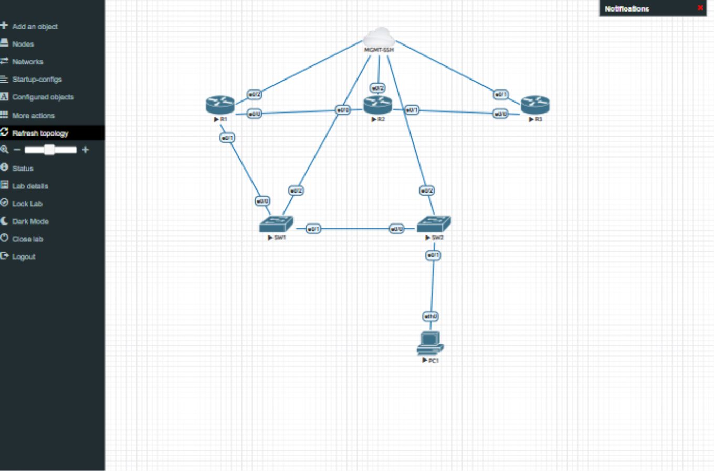

Mình dùng lab này để thực hành tự động hóa những việc thường làm khi cấu hình mạng: kết nối vào thiết bị, gửi cấu hình, kiểm tra trạng thái và sao lưu kết quả.

Lab có 6 node trong EVE-NG, gồm 3 router, 2 switch và 1 VPCS. Python chạy trên máy Windows bên ngoài EVE, kết nối SSH vào các thiết bị Cisco bằng Netmiko. Mục tiêu là làm được một quy trình nhỏ nhưng đầy đủ: sửa file cấu hình, triển khai lên thiết bị rồi kiểm tra xem mạng còn hoạt động đúng hay không.

## Sơ đồ lab

```text
R1 ───────── R2 ───────── R3
│
SW1 ──────── SW2
             │
            PC1
```

Ba router chạy OSPF area 0. Hai switch dùng VLAN 10, nối với nhau bằng trunk. PC1 nằm trong mạng `10.10.10.0/24` và dùng để kiểm tra kết nối tới gateway, switch và loopback của các router.

Ngoài các đường dữ liệu trên, cả 5 thiết bị Cisco đều nối tới Cloud0, đặt tên là `MGMT-SSH`. Đây là đường quản trị để máy Windows truy cập thiết bị qua SSH. Trên hai switch, đường này dùng VLAN 99.




| Thiết bị | Vai trò | Địa chỉ trong mạng lab |
|---|---|---|
| R1 | Router nối mạng LAN với các router còn lại | Loopback `10.255.0.1`; gateway LAN `10.10.10.1` |
| R2 | Router trung gian | Loopback `10.255.0.2` |
| R3 | Router ở đầu còn lại của mạng | Loopback `10.255.0.3` |
| SW1 | Switch nối R1 và SW2 | VLAN 10: `10.10.10.11` |
| SW2 | Switch nối PC1 | VLAN 10: `10.10.10.12` |
| PC1 | Máy kiểm tra kết nối | `10.10.10.100/24` |

Địa chỉ SSH được cấp qua DHCP và lưu trong `inventory.ssh.local.json` sau bước thiết lập. File này phụ thuộc vào môi trường đang chạy nên không đưa vào Git.

## Python làm những gì?

Chương trình có các thao tác sau:

| Thao tác | Công việc |
|---|---|
| `plan` | In cấu hình sẽ gửi để xem trước, chưa thay đổi thiết bị |
| `facts` | Thu thập trạng thái interface, OSPF, VLAN và trunk |
| `deploy` | Gửi cấu hình từ thư mục `configs/` và lưu trên thiết bị |
| `verify` | Kiểm tra IP, láng giềng OSPF, VLAN, trunk và ping |
| `backup` | Lưu running-config và startup-config của Cisco; lưu thông tin IP của PC1 |
| `all` | Triển khai, chờ mạng ổn định, kiểm tra rồi sao lưu |

Khi có `--transport ssh`, các thiết bị Cisco được quản lý qua SSH. PC1 vẫn dùng console của EVE vì VPCS không có SSH server. Kết quả mỗi lần chạy được lưu vào một thư mục riêng trong `runs/`.

## Cách chạy

Môi trường đã kiểm tra gồm Windows, VMware Workstation, EVE-NG, Cisco IOL L3/L2 và Python 3.12. Các thư viện chính là Netmiko 4.8.0 và Paramiko 4.0.0.

Nếu dựng trên máy khác, cần tạo topology trong EVE theo sơ đồ, chuẩn bị Cisco image phù hợp và sửa `inventory.json` cho đúng địa chỉ EVE cùng các cổng console. Project hiện chưa kèm file lab `.unl` và không kèm Cisco image.

Tại thư mục project, tạo môi trường Python và cài thư viện:

```powershell
python -m venv .venv
.\.venv\Scripts\python.exe -m pip install -r requirements.txt
```

Bật đủ 6 node trong EVE và chờ khởi động xong. Với lab mới chưa có cấu hình, triển khai bộ cấu hình ban đầu qua console:

```powershell
.\.venv\Scripts\python.exe lab.py all
```

Sau đó thiết lập SSH. Lệnh dưới dùng địa chỉ Windows VMnet8 của môi trường đã kiểm tra; thay bằng IP thực trên máy của bạn nếu khác:

```powershell
.\.venv\Scripts\python.exe setup_ssh.py --host-ip 192.168.126.1
```

Script yêu cầu nhập mật khẩu hai lần tại máy, tạo tài khoản `netadmin`, cấu hình mạng quản trị và thử đăng nhập SSH vào từng thiết bị. Mật khẩu không được ghi vào file project. Trước khi gửi mật khẩu qua SSH, script đối chiếu khóa máy chủ với khóa công khai đọc từ console.

Khi thiết lập thành công, kiểm tra lab bằng:

```powershell
.\.venv\Scripts\python.exe lab.py verify --transport ssh
```

Trên máy Windows đã chuẩn bị sẵn cho lab này, có thể dùng các file `BAT_SSH.cmd` và `KIEM_TRA_SSH.cmd`. Các file CMD là tiện ích cho môi trường hiện tại; các lệnh Python ở trên phù hợp hơn khi cài project trên máy khác.

## Một bài thực hành nhỏ

Ví dụ, để đổi mô tả cổng Ethernet0/0 trên R1, mở `configs/R1.cfg` và đổi dòng mô tả thành:

```text
interface Ethernet0/0
 description CONFIGURED_BY_PYTHON
```

Giữ nguyên các dòng cấu hình khác trong file. Xem trước và triển khai riêng R1:

```powershell
.\.venv\Scripts\python.exe lab.py plan --transport ssh --devices R1
.\.venv\Scripts\python.exe lab.py deploy --transport ssh --devices R1
```

Sau đó kiểm tra lại mạng và lấy bản sao cấu hình từ thiết bị:

```powershell
.\.venv\Scripts\python.exe lab.py verify --transport ssh
.\.venv\Scripts\python.exe lab.py backup --transport ssh --devices R1
```

Trong file `R1-running.cfg` của lần backup mới nhất, tìm `CONFIGURED_BY_PYTHON` để xác nhận thay đổi đã có trên router. Muốn hoàn tác bài này thì đổi mô tả về giá trị cũ và deploy lại.

Một điểm cần nhớ: deploy gửi các lệnh trong file, không tính phần chênh lệch với cấu hình đang chạy. Xóa một dòng khỏi file chưa có nghĩa là lệnh đó sẽ được xóa trên thiết bị.

## Kết quả đã kiểm tra

Trong lần chạy ngày **09/10/2026**, cả 5 thiết bị Cisco đều đăng nhập SSH thành công. Bước kiểm tra toàn lab đạt **25/25 điều kiện** trên 6 node, gồm:

- Interface có địa chỉ mong đợi và ở trạng thái up/up.
- Số láng giềng OSPF FULL trên R1, R2, R3 lần lượt là 1, 2, 1.
- VLAN 10 hoạt động và trunk chuyển tiếp VLAN 10.
- PC1 ping được gateway, hai switch và loopback của cả ba router.

Hai báo cáo được giữ lại tại [verified-results/ssh](verified-results/ssh). Đây là kết quả của lần chạy đã kiểm tra; khi đổi cấu hình hoặc khởi động lại lab, vẫn cần chạy verify lại.

## Một vài điều rút ra khi làm lab

Bật máy ảo EVE chưa có nghĩa là các node bên trong đã chạy. Đây là điều cần kiểm tra đầu tiên khi gặp lỗi connection refused.

Image IOS trong lab khá cũ. Paramiko 5 không còn hỗ trợ một số thuật toán SSH mà image này sử dụng, nên project cố định Paramiko ở bản 4.0.0. Hai switch cũng cần một khóa RSA riêng 2048-bit để dùng cho SSH. Đây là cách giữ tương thích với môi trường học hiện tại; khi làm với thiết bị mới, nên dùng firmware và thuật toán SSH mới hơn.

IP quản trị được cấp qua DHCP nên có thể thay đổi. Nếu địa chỉ đổi, chạy lại bước thiết lập để cập nhật inventory và xác minh khóa. Không cần thiết lập lại SSH mỗi buổi nếu địa chỉ và cấu hình vẫn còn nguyên.

Lab này tập trung vào cấu hình và kiểm tra bằng Python. Hiện chưa có Ansible, pipeline CI/CD hay cơ chế rollback tự động. Mình dùng nó làm nền để hiểu rõ từng bước trước khi mở rộng thêm.


Log chạy, inventory SSH cục bộ và file khóa đã được loại khỏi Git bằng `.gitignore`. Các bản backup sau khi bật SSH có thể chứa password hash, nên cần rà soát trước khi chia sẻ. Khi tải file qua giao diện web GitHub, hãy tự chọn đúng file cần đưa lên vì `.gitignore` không lọc các file bạn tải thủ công.
